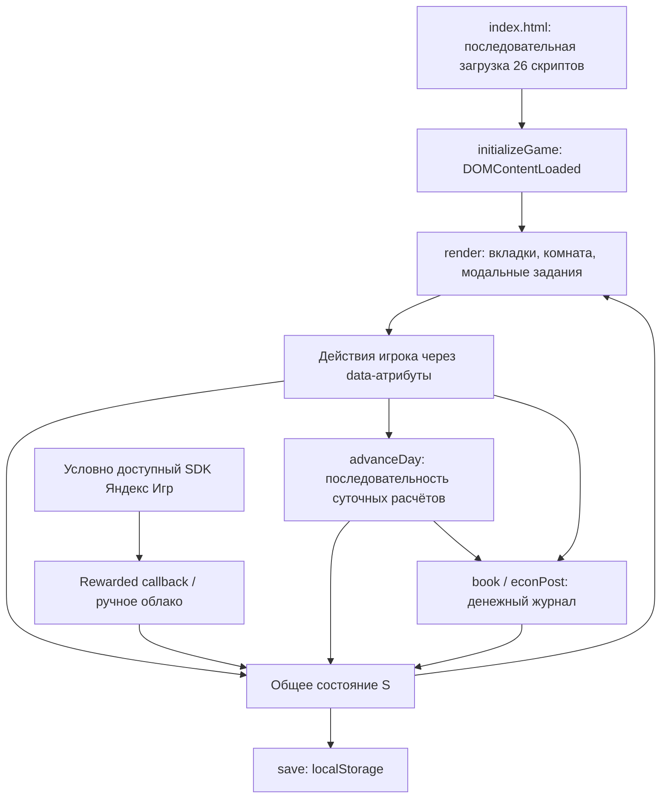

# Техническая архитектура «ИЗ НУЛЯ»

Дата анализа: 15.10.2026. Документ описывает существующий код, а не целевую архитектуру и не обещанный функционал.

> Обновление после анализа: повторение финансовых ID и поиск новых проводок по длине обрезаемого массива исправлены. Добавлены сохраняемый `nextLedgerId`, миграция старых ID/налоговых ссылок и регрессионные тесты. Подробности совместимости и актуальные результаты проверок — в [отчёте стабилизации ID](e2e/LEDGER_IDS.md). Остальной текст ниже сохраняет первоначальный срез анализа, включая исторические результаты тестов и описание обнаруженных тогда проблем.

> Следующее обновление: поступления товаров и возвраты переведены на общий складской слой; добавлены резервирование вместимости, очередь уже оплаченных товаров и история продаж с индивидуальной ценой и остатком права на возврат. Исправлены воспроизведённые переполнение склада и возврат по последней цене. Правила миграции, ограничения старых данных и результаты тестов — в [отчёте по складу и возвратам](e2e/WAREHOUSE_RETURNS.md).

## 1. Основания и границы анализа

Изучены `index.html`, все 26 подключённых игровых JavaScript-файлов, `style.css`, конфигурация npm/Playwright, исходники тестов в корне и `e2e/`. README не использован как доказательство наличия механик.

Обозначения:

- **Факт** — прямо следует из указанных исходников.
- **Воспроизведено** — дополнительно проверено запуском настоящих функций в изолированном Node.js VM с фиктивными DOM/localStorage, без записи файлов и без изменения реального сохранения игрока.
- **Риск / вывод** — архитектурное следствие кода; не означает, что соответствующая ошибка уже воспроизведена в браузере.
- **Предложение** — направление развития, ещё не реализованное в проекте.

В рамках анализа заново выполнены все 29 существующих Node.js-тестов: **29 прошли, 0 не прошли**. Полный Playwright-прогон не запускался, чтобы выполнить требование создать только этот файл и не перезаписывать отчёты. Существующий `e2e/RESULTS.md` фиксирует предыдущий результат **44/44**, а `test-results/.last-run.json` содержит `status: passed`; это исторические результаты, не новый браузерный прогон данного анализа.

Игровые файлы, тесты, настройки и сохранения в ходе анализа не изменялись.

## 2. Общая архитектура

**Факт.** Это клиентское приложение на обычных HTML/CSS/JavaScript, построенное вокруг вкладок, DOM-сцены комнаты, модальных мини-игр и пошаговой экономической симуляции. Существующая 2D-комната выполнена средствами CSS и HTML; город — сетка кнопок перехода к системам.

В игровых исходниках нет ES-модулей, сборщика, отдельного игрового сервера или API собственного backend. `@playwright/test` и `http-server` — зависимости разработки; браузер не импортирует их из `node_modules`. `npm run serve:e2e` запускает статический сервер на `127.0.0.1:4173`, а не сервер экономики.

Основные слои фактической реализации:

| Слой | Реализация |
| --- | --- |
| Оболочка | `index.html`: шапка ресурсов, `#nav`, `#main`, `#modal`, `#toast` |
| Состояние | Общий изменяемый объект `S` и добавляемые в него структуры |
| Команды игрока | Делегированные обработчики `click`, `change`, `input`; атрибуты `data-*` |
| Расчёты | `book`, `advanceDay`, `workResult`, `runProjectDay` и отраслевые функции |
| Экраны | Функции, возвращающие HTML, и цепочка обёрток `render` |
| Сохранение | JSON всего `S` в localStorage; ручной импорт/экспорт; условная облачная интеграция |
| Платформа | `platform.js` и облачные функции `simulation_v8.js` |
| Проверки | Node.js VM/assert и отдельные браузерные тесты Playwright |



Это схема зависимостей, а не существующий диспетчер событий: единой шины команд или доменных событий в коде нет.

### 2.1. Как подключаются расширения

`index.html` содержит классические `<script src="...">` в конце `body`, без `type="module"`, `async` или `defer`. Вкладки добавляются динамически в DOM, но сами игровые скрипты подключены статическим последовательным списком. Отдельная динамическая загрузка есть у платформенного SDK.

Большинство расширений использует схему:

```javascript
const previous = render;
render = function () {
  if (tab === 'новая_вкладка') { /* показать экран */ return; }
  return previous();
};
```

Так же оборачиваются `advanceDay`, `startWork`, `workResult`, `closeModal`, `runProjectDay`, `book`, `net` и `classify`. Часть поздних файлов оформлена IIFE, но это скрывает только локальные переменные: зависимости от общих функций и `S` остаются.

### 2.2. Первый запуск и устранённая ошибка вкладок

`game.js:17`, `initializeGame()` подписан на `DOMContentLoaded` с `once: true`. Он проверяет `S.tab` по готовому `#nav button[data-tab]`, заменяет неизвестный ID на `home` и вызывает окончательную версию `render`. Флаг `gameInitialized` защищает от повторной инициализации.

Преждевременные стартовые вызовы `render()` из модулей убраны. Поэтому сохранённый `inventory23` теперь обрабатывается после подключения склада и остальных расширений. Таймеров и перехвата TypeError для обхода проблемы здесь нет.

**Риск.** Это корректная граница для нынешнего списка синхронных скриптов. Явного реестра модулей, графа зависимостей и ожидания произвольных будущих асинхронных игровых модулей пока нет. Наличие кнопки также не является формальным доказательством регистрации функции её экрана.

## 3. Реальные файлы и порядок подключения

Порядок ниже точно соответствует `index.html`. В колонке функций приведены основные точки входа, а не полный список вспомогательных функций.

| № | Файл | Назначение и ключевые функции |
| ---: | --- | --- |
| 1 | `game.js` | Каталоги `WORK`, `PROJECTS`, `ASSETS`; `initial`, `initializeGame`, `book`, `save`, `openProject`, `produce`, `hire`, `startWork`, `workResult`, базовый `render`, импорт/экспорт в `act` |
| 2 | `economy.js` | `ensureEconomy`, `econInvoice`, `collectInvoices`, отраслевой `runProjectDay`, `classify`, `incomeStatement`, `economics`; заменяет первоначальную универсальную пассивную экономику |
| 3 | `expansion.js` | `ext`, бытовые режимы, `agencyApply`, `processApplications`, старый слой YouTube/MCN, `monetizeChannel`, расширение финансового экрана |
| 4 | `world.js` | `worldState`, `worldRoom`, `useLocation`, цели `claimMission`, жильё `moveHouse`, срочные предложения `acceptOffer`; полностью заменяет основное тело `advanceDay` |
| 5 | `systems.js` | `sys`, карта `cityScreen`, обучение `study`, погашение долга `creditPayment`, справочник налогов, график капитала |
| 6 | `minigames.js` | `TASK_BLUEPRINTS` для всех 24 профессий, `taskBody12`, `careerAction12`; заменяет базовые мини-игры, Web Audio для ритмических заданий |
| 7 | `platform.js` | `initYandex`, `watchRewarded`, `awardEnergy`, статус SDK, экран добровольных бонусов |
| 8 | `simulation_v8.js` | Ограниченный рынок смен: `labourState`, `refreshLabour`, `beginLabour`; `financialRows`, `projectProfit`; `cloudSaveV8`, `cloudLoadV8` |
| 9 | `finance_v9.js` | `v9DailyCosts`, `v9Forecast`, `v9LedgerBalance`, `v9Audit`: сценарий ликвидности и сверка журнала |
| 10 | `strategy_v10.js` | `strategyState`, `chooseStrategy`, `strategyPreview`, `createStrategicRelease`: органический рост, качество, платное продвижение |
| 11 | `contracts_v11.js` | `contracts11`, `newOffers11`, `takeContract11`, `settleContracts11`: клиентские договоры по профессиям, задержки, споры и неоплаты |
| 12 | `deep_v13.js` | Углублённые задания для `w6`, `w17`, `w18`: `open`, `act`, `finish`; перехватывает `startWork` и очистку модального задания |
| 13 | `business_v14.js` | Бизнес-практикум по семи типам предприятий: `defs`, `state`, `start`, `act`, `settle`; здесь находится общий товарный остаток `byProject` |
| 14 | `youtube_v15.js` | `storage`, `channel`, `create`, `simulate`, `pitch`; индивидуальные видео и каналы; заменяет дневную обработку шести YouTube-проектов |
| 15 | `video_editor_v16.js` | `newDraft`, `estimate`, `submit`: учебный редактор сцен/обложки/звука/прав, публикация через `YouTubeV15.create` |
| 16 | `youtube_business_v17.js` | Медиа-компания: `state`, `candidates`, `accept`, `attach`, `settle`, `plan`, `assign`, `dayUpdate`, `videoFinance` |
| 17 | `realism_v18.js` | `realism18`, `expense18`, `refreshHousing18`, региональный коэффициент `book`; `classifyReceipt18`, `annualTax18`, `payNpd18`; опциональная индексация |
| 18 | `labour_v19.js` | `labour19`, `labourStats19`; обёртка `workResult`, собирающая наблюдения о сменах из журнала |
| 19 | `cash_audit_v20.js` | `cashAudit20`, `cashAuditScreen20`: разделение начисленного, полученного, ожидаемого, спорного и потерянного дохода |
| 20 | `risk_v21.js` | `riskProjection21`, `riskScreen21`: сценарии оплат/болезни/ремонта/задержек; используется поздним вызовом из `v9Forecast` |
| 21 | `inventory_v23.js` | `record`, `stats`, `price`, `buy`, `sell`, `refund`: ручное управление складом, ценами, продажами и возвратами |
| 22 | `suppliers_v26.js` | `SUPPLIERS`, `order`, `pending`, `deliver`, `inventoryValue`: предоплаченные поставки в пути |
| 23 | `team_v27.js` | `team`, `hireRole`, `fireRole`, `workday`: отдельная ролевая команда и суточные задачи |
| 24 | `training_v28.js` | `member`, `level`, `efficiency`, `train`; начисление XP после работы команды |
| 25 | `morale_v29.js` | `morale`, `praise`, `bonus`, `removeBonus`, `retention`: мотивация, доплаты, пропуски смен и уход |
| 26 | `competition_v30.js` | `state`, `rivalPrice`, `score`, `canSell`, `advertise`, `daily`: конкуренция при продажах оператором |

Дополнительно: `style.css` содержит общую тему, карточки, комнату, город, мини-игры и адаптивные правила. `playwright.config.js` не подключается в игру. Номера версий в именах файлов обозначают историю расширений, а не независимые пакеты или версии схем сохранения.

## 4. Игровое состояние и сохранения

### 4.1. Базовая модель

`game.js:11`, `initial()` создаёт:

```text
S
├── version: 3
├── day: 1, cash: 1500, debt: 0
├── energy: 90, stress: 12, hours: 12
├── rep: 0, seed: 0, lastBonus: 0
├── skills: {}                 # ключи профессий w0…w23
├── owned: []                  # индексы предметов ASSETS
├── projects: {}               # проекты p0…p23
├── ledger: [], events: []
├── tab: 'home', workCount: 0
└── economy                    # добавляется ensureEconomy()
```

Открытый проект начинается как `{open, posts, audience, staff, automation}`. `ensureEconomy()` добавляет ему `metrics`: просмотры, заказы, оплаченные заказы, подписчики, возвраты, контент. Позднее внутри проекта появляются `team27` и `competition30`.

### 4.2. Фактическое размещение расширений

```text
S.economy
├── receivables, seq, losses, stats, history, settings
├── expansion                    # ext() возвращает именно этот объект
│   ├── living, contracts, channels, statistics, log
│   ├── costBreakdown, deals, settings, credit
│   ├── world                    # жильё, цели, срочные заказы
│   ├── realism18                # регион, индекс цен, налоговые классификации
│   └── labour19.sessions        # наблюдения о выполненных сменах
├── systems                      # обучение, погашенные долги, настройки
├── labour8                      # ограниченный рынок смен
├── contracts11                  # предложения, active, pending, history
├── strategy10                   # стратегии и история выпусков
├── business14                   # history, round, byProject[id]
│   └── byProject[id]            # stock, salePrice, unitsSold, возвраты, deliveries
├── yt15                         # channels, seq, history
└── youtubeBusiness17            # contracts, calendar, history, seq

S.projects[id].team27            # members, nextId, history
S.projects[id].competition30     # campaignUntil, spent, sales, lost, history
```

**Факт.** Корневого `S.ext` в реализации нет. Название `ext()` не должно вводить в заблуждение при дальнейшем изменении сохранений.

Многие функции чтения одновременно создают структуру: `worldState`, `team`, `record`, `channel`, `state` в расширениях. Поэтому открытие экрана может изменить `S` даже без экономической операции. Это пока способ ленивой совместимости, а не чистые селекторы состояния.

### 4.3. Запись и восстановление

- `save()` (`game.js:29`) присваивает `S.tab = tab` и синхронно сохраняет JSON в localStorage под ключом **`iz_nulya_v3_state`**. Ошибка хранилища показывается через toast.
- На старте JSON читается в `game.js:12`. При ошибке разбора или несовпадении `version` используется `initial()`. Полной проверки полей и миграций между версиями нет.
- Добавочные структуры обычно создаются проверками `if (!...)`; это совместимость с отсутствующим целым блоком, а не нормализация каждого вложенного поля.
- Навигация через базовый обработчик `data-tab` сохраняется автоматически. Некоторые другие переходы, например `world.js/useLocation` и `systems.js/data-city`, вызывают только `render`; их вкладка сохраняется при следующем `save`, а не обязательно сразу.
- Автосохранение вызывается из множества операций и нескольких фаз дня; единого расписания сохранения и транзакционной границы нет.
- `act('exportjson')` экспортирует `S`; CSV экспортирует журнал. JSON-импорт проверяет версию, массив `ledger` и конечное число `cash`, затем присваивает `S` и открывает `home`. Поля `projects`, `owned`, `skills` и состояние расширений глубоко не проверяются.
- `cloudSaveV8`/`cloudLoadV8` (`simulation_v8.js:26–27`) действительно реализованы: ручной вызов `setData/getData`, проверка размера JSON через `TextEncoder` с внутренним порогом 190000 байт, подтверждение замены и более широкий набор базовых проверок при загрузке. Локально кнопки отключены без `yandexPlayer`. Внешние ограничения платформы здесь не верифицировались.

### 4.4. Что не восстанавливается целиком

`tab` дублируется между `S.tab` и переменной интерфейса. Фильтры, поиск, период отчётов, выбранные каналы, `modal`, `activeCareer`, сессии `DeepCareer13`/`BusinessV14`, черновик видеоредактора и этап монтажа находятся в переменных/замыканиях, а не в полном сохраняемом UI-состоянии.

Прогресс незавершённой мини-игры и черновик редактора после reload не возобновляются. При этом некоторые сведения о принятом заказе могут лежать в сохраняемых структурах (`contracts11.active`, `world.activeOffer`), то есть статус заказа и несохранённая сессия задания имеют разный жизненный цикл. Корректное восстановление таких комбинаций не подтверждено существующими браузерными сценариями.

`deep_v13.js/finish` дополнительно пишет историю в ключ `iznulya_deep_v13_history`, но соответствующего чтения этой истории при запуске в подключённых исходниках нет. Это отдельная неполная ветвь персистентности.

## 5. День, ресурсы и финансовые операции

### 5.1. Откуда берётся игровой день

Основное время пошаговое. `world.js/useLocation('bed')` вызывает `rest()`, а тот — текущий `advanceDay()`, затем `save()` и `render()`. Таймер реального времени не переключает дни. В просмотренных игровых исходниках нет `requestAnimationFrame` или отдельного цикла обновления пространственного мира.

Важна разница между историческими и действующими функциями: `game.js/advanceDay`, затем `economy.js/advanceDay` и `expansion.js/advanceDay` существуют в источниках, но `world.js:20` заменяет тело дня целиком, не вызывая предыдущую функцию. Считать все три ранних набора расходов одновременно действующими было бы ошибкой.

### 5.2. Реальный порядок суточных эффектов в полной игре

Внешняя обёртка вызывает предыдущую, поэтому эффекты выполняются изнутри наружу:

| Порядок | Источник | Эффект |
| ---: | --- | --- |
| 1 | `world.js/advanceDay` | День +1, часы =12, энергия +52 с ограничением 100, стресс −16 с ограничением 0 |
| 2 | Там же | `collectInvoices`; операционные расходы каждого открытого проекта, старые сотрудники `staff × 650`; текущий `runProjectDay` |
| 3 | Там же | Решения MCN `processApplications`; пять статей бытовых расходов через текущую `houseExpenses`; возможный недельный расход |
| 4 | Там же | Превращение нехватки денег в долг, проценты 0,06% за день при положительном долге; снимок `economy.history`, счётчик дней, срочные предложения |
| 5 | `simulation_v8.js` | `refreshLabour`: обновление рынка смен |
| 6 | `contracts_v11.js` | `newOffers11`, затем поступления/споры/потери по отдельным профессиональным договорам |
| 7 | `youtube_business_v17.js` | Просроченные планы, рекламные договоры и их оценка `dayUpdate` |
| 8 | `realism_v18.js` | Опциональный пересчёт индекса цен после 30 дней; новые цены действуют для последующих расчётов |
| 9 | `suppliers_v26.js` | `deliver`: поступление оплаченных партий |
| 10 | `team_v27.js` | `workday`: зарплаты, продажи операторов, маркетинг, заявки закупщиков; своя нормализация отрицательной кассы в долг |
| 11 | `training_v28.js` | XP по персональным ID сотрудников из отчёта смены |
| 12 | `morale_v29.js` | Снижение мотивации и уход выгоревших сотрудников |
| 13 | `competition_v30.js` | Снимок конкуренции и сохранение |

**Вывод.** Снимок финансов дня создаётся до поздних договорных выплат и работы команды. Доставка доступна оператору в этот же день, но основной автоматический спрос проекта уже рассчитан до доставки. Это реальные последствия порядка кода, а не независимые параллельные системы.

### 5.3. Деньги и журнал

`book(category, amount, source, note, project)` (`game.js:27`) округляет сумму до целого рубля, проверяет конечность, меняет `S.cash` и добавляет запись `{id, day, category, amount, source, note, project}`. `econPost` — тонкий вызов `book`. Списание и ресурсная операция обычно выполняются отдельными присваиваниями, без общего объекта транзакции.

Начальные 1500 ₽ задаются в `initial`, без записи об открытии баланса. `v9LedgerBalance` суммирует только журнал. Списания, создающие дефицит, могут сопровождаться прямыми присваиваниями `S.cash=0` и ростом `S.debt`, без отдельной записи финансирования. Поэтому журнал — реестр денежных игровых операций, но не полноценная самосверяющаяся бухгалтерская модель.

`ledgerTotals`, `incomeStatement`, `financialRows` и `cashAudit20` считают разные показатели разными списками строковых категорий. `net()` начинается с денег, оценки имущества/проектов и долга; `world.js` добавляет текущий залог жилья. Дебиторская задолженность добавляется отдельно в экономическом аудите. Товары и поставки в пути не включены в стандартный `net`, хотя `Suppliers26.inventoryValue()` умеет их отдельно оценивать.

### 5.4. Энергия, навыки и заработок

`WORK` содержит 24 профессии с ID `w0…w23`, категориями, часами, базовой оплатой, издержками и типом задания. Для старта смены обычно проверяются доступные часы и минимум 15 энергии. При завершении `workResult` списывает `13 + 3 × job.hours` энергии с ограничением снизу 0; стартовая проверка не требует иметь всю эту сумму.

Базовое начисление:

```text
gross = round(job.base × quality × (1 + min(25, skill) × 0,012))
quality при успехе: случайное значение 0,88…1,16
quality при неуспехе: случайное значение 0,38…0,70
```

Проводятся валовая оплата и рабочие издержки, навык повышается на 1, `workCount` растёт. `realism_v18.js/book` дополнительно умножает положительную «Оплату труда» офлайн/гибридных профессий на коэффициент выбранного региона. Прочие премии и категории не получают этот коэффициент автоматически.

`systems.js/study` за 1800 ₽, 3 часа и 14 энергии добавляет +5 к навыку. `S.rep` читается стратегиями, но механизма его роста в подключённом коде не найдено. Большинство случайных величин использует `Math.random`; `S.seed` не обеспечивает воспроизводимость симуляции.

## 6. Реализованные подсистемы

### 6.1. Подработки: три рынка и два уровня заданий

1. **Основная биржа** — `game.js/works`, `startWork`: список всех профессий. Сам по себе этот список не ограничивает число доступных предложений; ограничения — ресурсы игрока.
2. **Срочные предложения** — `world.js/newOffer`, `acceptOffer`: сроки, статус заказа, дополнительная премия при успехе.
3. **Рынок вакансий 2.0** — `simulation_v8.js/refreshLabour`, `beginLabour`: до десяти предложений, срок действия, коэффициент ставки и завершение предложения.
4. **Договоры с клиентами** — `contracts_v11.js`: до семи предложений онлайн/гибридной работы, согласованная сумма, отсрочка, спор и потеря оплаты. Это ещё одна ветвь поверх профессий, а не общий реестр всех заказов.

`minigames.js` содержит определения для всех 24 профессий: последовательности действий, классификацию, память, арифметику, редактуру, выбор формулы, ползунки, рекламу и секвенсор. `deep_v13.js` позднее заменяет задания `w6` (Shorts), `w17` (медиабаинг), `w18` (битмейкер) трёхэтапными сценариями. Показанные там учебные бюджеты/результаты не равны самостоятельным операциям над реальными деньгами игрока: оплату выполняет общий `workResult`.

`workResult` в полной игре проходит через обёртки `labour_v19 → contracts_v11 → simulation_v8 → world → game`. `contracts_v11` сначала использует обычное начисление, затем сторнирует его и создаёт отдельное ожидание оплаты. `labour_v19` анализирует прирост журнала, а `cash_audit_v20` заменяет контрактные начисления согласованными суммами. Сопоставление смен и договоров идёт по дню/профессии и количеству, без единого ID сессии.

### 6.2. Общая модель предприятий

`PROJECTS` содержит 24 направления семи типов: `music`, `media`, `agency`, `ads`, `commerce`, `offline`, `saas`. `openProject` проверяет стартовый капитал, списывает инвестицию и создаёт проект. Закрытия/продажи предприятия как полноценного жизненного цикла в просмотренных интерфейсах нет.

- `produce` расходует 3 часа и 17 энергии, увеличивает `posts` и `audience`; слой экономики добавляет метрики контента.
- `strategy_v10` даёт альтернативный выпуск с выбором стратегии, расходом ресурсов, риском и историей результатов.
- `business_v14` предлагает три решения по типу бизнеса и рассчитывает последствия: партии товаров, CPA-счета, клиентские счета, материалы/лицензии или оборот офлайн-смены.
- `runProjectDay` моделирует отраслевые процессы: лицензии на биты, интеграции/платформенные доходы не-YouTube медиа, заказы агентств и SaaS, продажи со склада, офлайн-оборот с затратами и возвратами, покупку трафика и отложенные CPA-выплаты.

**Ограничение.** Универсальные `posts` и `audience` означают одновременно публикации, выполненные работы и коммерческое развитие. Кофейня, SaaS и агентство представлены абстрактными коэффициентами и учебными сценариями; отдельных помещений, продукта SaaS, ингредиентов, расписания смен или полноценного управления клиентскими проектами нет.

### 6.3. Склад, продажи и поставщики

Общий остаток торгового проекта расположен в `S.economy.business14.byProject[id]`. Его используют пять путей: бизнес-практикум, ручной склад, автоматический `economy.js/runProjectDay`, оператор команды и поставщики. Это положительная связь: каждый путь продажи списывает фактический общий остаток.

`inventory_v23.js` реализует немедленную закупку партий 5/10/20 по 420 ₽, ручную цену, продажу 1–10 единиц за 2 часа/10 энергии, комиссию 18%, логистику 110 ₽ на единицу. Публичный `sell` допускает 1–10, интерфейс предлагает 1 и 5. Исправный возврат восстанавливает склад, повреждённый — увеличивает `damaged`. Возвратить можно только накопленные ручные продажи; автоматические продажи не создают такой же реестр возвратов.

`suppliers_v26.js` добавляет три сценария: 350 ₽/ед. +700 ₽ за 5 дней, 390 ₽/ед. +450 ₽ за 3 дня, 440 ₽/ед. +250 ₽ за 1 день. Предоплата и доставка списываются сразу, товар появляется по `due`. Статус `delivered` защищает от повторного поступления той же партии.

Себестоимость партий не ведётся по FIFO/средней цене. `Inventory23.stats` и складская часть `Suppliers26.inventoryValue` оценивают единицу в 420 ₽ даже после закупки у поставщика с другой ценой. В пути учитывается цена закупки, но не единая капитализация доставки. Между каналами закупки неодинаково проверяется вместимость склада; воспроизведение приведено в разделе 8.

### 6.4. Персонал, обучение, мотивация и конкуренция

Существуют **две отдельные модели сотрудников**:

- `game.js/hire`: число `p.staff`, растущая стоимость найма, 650 ₽/сутки на человека, коэффициенты аудитории/спроса. Персональных сущностей и увольнения у этой модели нет.
- `team_v27.js`: `p.team27.members`, до шести сотрудников, персональные ID и роли `operations`, `marketing`, `procurement`. Базовые оклады 520/760/630 ₽, начальные расходы на подбор; требуется резерв на три дня. Это не автоматическая миграция старого `staff`.

Команда получает оклад независимо от результата. Оператор продаёт при наличии товара и спроса, маркетолог увеличивает аудиторию, закупщик при низком запасе заказывает пять единиц у стандартного поставщика с учётом товара в пути. Влияние XP/обучения встроено непосредственно в `team_v27/workday` для операторов и маркетологов.

`training_v28` начисляет XP по отчёту сотрудника; обучение стоит 1800 ₽, максимум три курса. Показанный коэффициент `efficiency()` не является универсальным множителем рабочего результата: роли используют свои отдельные формулы. Закупщик не получает аналогичную формулу производительности.

`morale_v29`: по умолчанию 60 мотивации, ежедневное уменьшение на 3 или на 1 при доплате, беседа +12 за 1 час/5 энергии раз в день, назначение доплаты 25%, отмена доплаты. Ниже 20 сотрудник пропускает работу, но получает оплату; после четырёх дней выгорания уходит. Снижение мотивации выполняется после работы, поэтому пороги нужно интерпретировать с учётом этой последовательности.

`competition_v30` использует сценарную цену соперника и воспроизводимый по проекту/дню порог спроса. Рекламная кампания стоит 1200 ₽ и действует до `S.day+2`. **Она влияет на `Team27`-оператора, но не на ручной `Inventory23.sell`, не на практикум и не на основной автоматический спрос `runProjectDay`.** Несколько операторов одного проекта в один день получают одну и ту же проверку `canSell`, а не независимые случайные исходы.

### 6.5. YouTube и видеоредактор

`youtube_v15.js` обслуживает ровно `p2,p3,p4,p5,p6,p8`. Состояние каналов/роликов находится в `economy.yt15`, а более старые MCN-контракты — в `economy.expansion.contracts`.

- `create` проверяет деньги/часы/энергию, списывает производство/продвижение, создаёт ролик, повышает `posts` и метрики.
- `simulate` в следующие игровые дни рассчитывает показы, просмотры, подписчиков, источники трафика, затухание охвата и условные рекламные начисления.
- Начисления допускаются при одобренном MCN, международной аудитории ролика, отсутствии претензии, пороге подписчиков и публикаций. После комиссии 20% выставляется счёт с задержкой 12 дней через общую дебиторскую задолженность.
- `pitch` — отдельный ручной поиск прямой интеграции с расходом времени/энергии и вероятностью успеха.
- Обёртка `runProjectDay` для этих шести проектов вызывает только новый `simulate` и не пропускает их в старую общую обработку медиа. Поэтому считать старый и новый рекламный доход одновременно действующими неправильно.

`video_editor_v16` — игра в редакторские решения: до 12 выбранных сцен, порядок, длительность, заголовок, голос, музыка, субтитры, обложка, права, расчёт качества/CTR/удержания. `submit` передаёт результат в `YouTubeV15.create`. Реальные видеофайлы не монтируются, не декодируются и не экспортируются.

`youtube_business_v17` реализует предложения трёх рекламодателей, переговоры, привязку одного ролика, дедлайны, полную/частичную оплату по результату и счёт. Календарь — список планов с привязкой выпущенного видео и пропусками; он не публикует ролики автоматически. `videoFinance` явно возвращает `cashRealized:false`: его результат начисленный, а не подтверждённый денежный поток конкретного ролика.

**Связи и расхождения.** Выбор стратегии или общий `produce` может менять `p.audience/posts` без создания видео. Канал хранит свои `subscribers`, а `simulate` затем присваивает их `p.audience`: единого владельца показателя аудитории нет. В `create` бонус навыка читается по строке `'Монтаж Shorts'`, тогда как обычные навыки хранятся по ID `w6`; стандартная прокачка не попадает в этот lookup. В `VideoEditorV16.estimate` вариант исходника `licensed` не удовлетворяет условию `source==='original'`, то есть помечается как проблема прав; это не полноценная модель лицензирования.

### 6.6. Музыка и реклама

Музыка реально присутствует в двух формах: профессиональное задание `w18` с ритм-секвенсором и Web Audio-прослушиванием, а также проекты `p0/p1` с выпуском материалов и условными лицензионными счетами. Есть учебные решения о правах. Полноценного редактора аудиодорожек, загрузки/экспорта музыки, каталога реальных лицензий и дистрибуции на внешние платформы нет.

Медиабаинг `w17`, проект `ads` и товарная кампания `competition30` — разные реализации. Первая — оплачиваемое профессиональное задание, вторая — затраты на трафик/CPA-счета, третья — влияние на спрос оператора. Их учебные параметры не следует автоматически объединять как один рекламный кабинет.

### 6.7. Жизнь, налоги, прогнозы, платформа

- Комната и карта: `worldRoom`, `useLocation`, `cityScreen`; взаимодействия кнопочные. Жильё меняет оформление, аренду и залог; цели дают явно оформленную игровую субсидию через `claimMission`.
- Регион: четыре набора расходов и коэффициентов в `RE18.regions`; `expense18` заменяет `houseExpenses`, поэтому базовая бытовая корзина в полной игре не должна списываться повторно из старых функций.
- НПД: справочник в `systems.js` и отдельный учебный кабинет в `realism_v18.js`. Игрок вручную классифицирует допустимые поступления как физлицо/бизнес/исключение; считается текущий 365-дневный игровой год, лимит, оплаченные строки и разовая уплата. Это частичный налоговый сценарий, не полный режим предпринимательства.
- `riskProjection21` — сценарий без новых заказов/продаж; `v9Forecast` при наличии модуля делегирует ему расчёт с 50% оплат. Он берёт только общие `economy.receivables` и расходы `v9DailyCosts`. Отдельные `contracts11.pending` и оклады новой команды туда не попадают.
- SDK Яндекс Игр загружается условно по `location.ancestorOrigins` с доменом Яндекса. Реализованы инициализация, вызовы LoadingAPI/GameplayAPI, rewarded callback и получение игрока. Локально SDK не подменяется фиктивными просмотрами рекламы. Реальная авторизация, реклама и облако в среде Яндекс Игр данным анализом не проверялись.

Числа, названные в коде официальными, и внешние ссылки описаны здесь как содержимое исходника. Этот документ не подтверждает актуальность законодательства, статистики, тарифов, доходности или правил SDK. Региональные цены, RPM, ставки, спрос и зарплаты — параметры игры.

## 7. Важные связи между системами

| Связь | Реальная зависимость и следствие |
| --- | --- |
| День → все предприятия | `world.advanceDay` вызывает текущий `runProjectDay`; поздние обёртки дополняют день |
| Профессия → ресурсы → финансы | Мини-игра заканчивается через `workResult`, который списывает время/энергию и пишет журнал |
| Договор → доход/аналитика | `contracts11` сторнирует обычную оплату; `labour19` и `cashAudit20` восстанавливают смысл начислений |
| Поставщик → склад → оператор | `Suppliers26` и `Team27` используют `Inventory23.record`, который обращается к `BusinessV14.state` |
| Обучение/мотивация → команда | Развитие читает отчёты `Team27`, мотивация определяет допуск к смене и дальнейший уход |
| Конкуренция → оператор | `workday` обращается к `Competition30.canSell` во время суточной продажи |
| Редактор → YouTube → счета | `VideoEditorV16.submit` → `YouTubeV15.create` → `simulate` → `econInvoice` → `collectInvoices` |
| Медиа-контракт → ролик → счета | `YouTubeBusinessV17.attach/settle` использует ролики `YouTubeV15` и общую дебиторскую задолженность |
| Регион → расходы/оплата | `expense18` обслуживает реальный день и прогноз; обёртка `book` меняет оплату части профессий |
| Журнал → налоги/аналитика | Категории и ID записей определяют классификацию поступлений, статистику смен и уплату |
| UI → персистентность | Переходы и действия часто вызывают `save`, но не все переходы используют один и тот же путь |

## 8. Дублирование, технический долг и конфликты

### 8.1. Подтверждённые проблемы и расхождения

| Проблема | Основание | Последствие |
| --- | --- | --- |
| Повторение ID журнала после обрезки — **воспроизведено** | `game.js/book`: `id = ledger.length+1`, при длине >12000 сохраняются последние 10000 | ID перестаёт быть уникальным; налоговые отметки используют эти ID как ключи |
| Разные проверки вместимости — **воспроизведено** | `Suppliers26.order` учитывает запас + поставки в пути, `Inventory23.buy` — только текущий запас; `deliver` просто добавляет партию | Через реальные каналы закупок можно превысить лимит 100 |
| Возврат по последней цене — **воспроизведено** | `Inventory23.sell` накапливает `refundable`, но хранит единственный `refundPrice`; `refund` применяет его ко всему количеству | Возврат продаж с разными ценами списывает неверную сумму |
| Расходы команды отсутствуют в прогнозе — **воспроизведено** | `finance_v9.js/v9DailyCosts` учитывает upkeep + старый `staff × 650`, но не `team27` и бонусы | «Обязательные расходы» и кассовый сценарий занижены для нового персонала |
| Категории договорной оплаты не совпадают — **воспроизведено** | `settleContracts11` пишет «Поступление по договору», `eligibleReceipts18` ожидает «Оплата по договору» | Реальное положительное поступление не предлагается для налоговой классификации |
| Новые сотрудники не учтены в налоговом запрете | `realism_v18.js/npdBan18` проверяет `p.staff`, но не `p.team27.members` | Две кадровые модели по-разному видны налоговой подсистеме |
| Постоянная себестоимость 420 ₽ | `Inventory23.stats`, `Suppliers26.inventoryValue`, альтернативные цены `SUPPLIERS` | Показанные маржа/стоимость запаса не отражают фактические партии и доставку |
| Разные значения капитала в разных экранах | `net`, `economics`, `economy.js/render`, `inventoryValue` | Верхняя панель на `econ` включает общие счета, на других вкладках — нет; товарный капитал считается отдельно |
| Суточная финансовая история неполна | `world.advanceDay` делает snapshot до `settleContracts11` и `Team27.workday` | График дня может отличаться от окончательного состояния дня |
| Конкуренция действует на один канал продаж | `Competition30.canSell` вызывается из `Team27.workday` | Поведение ручных и суточных продаж не соответствует единому рынку спроса |
| Два счётчика аудитории YouTube | `produce/createStrategicRelease` меняют `p.audience`, `simulate` пишет `p.audience=c.subscribers` | Межсистемные эффекты могут перезаписывать друг друга |
| Несогласованный ключ навыка YouTube | `YouTubeV15.create`: `S.skills['Монтаж Shorts']`, обычная работа: `S.skills.w6` | Прокачка стандартного навыка не используется указанным бонусом качества |
| Лицензированные исходники считаются проблемными | `VideoEditorV16.estimate`: `rights` требует `source==='original'` | Предложенный интерфейсом `licensed` всё равно приводит к претензии в модели |

Наличие этих дефектов не означает, что любая торговая или налоговая операция неверна. Проблемы относятся к конкретным сочетаниям путей и полей, перечисленным в таблице.

### 8.2. Результаты изолированных воспроизведений

Использовались настоящие 26 скриптов из списка `index.html`, отдельный VM-контекст и фиктивный localStorage. Подготовленные состояния служат для анализа инвариантов; это не подмена прохождения в браузерных тестах и не изменения реального профиля игрока.

1. **Журнал:** после 12002 вызовов `book` в свежем состоянии осталось 10001 записей, но только 10000 уникальных ID; последний ID — 10001.
2. **Склад:** пять заказов у поставщика по 20 единиц при пустом складе, затем прямая закупка 20 единиц; после наступления срока и `deliver()` получено **120 единиц** при заявленном максимуме 100. В этой проверке проверялась доставка изолированно, без расходования товара в промежуточные дни.
3. **Возвраты:** ручные продажи одной единицы по 690 ₽ и одной по 1490 ₽ дали выручку 2180 ₽, но `refund(...,2)` списал **2980 ₽**.
4. **Прогноз:** у открытого `p19` с нанятым маркетологом `v9DailyCosts().firms` вернул **2200 ₽**, то есть только upkeep; ежедневный оклад **760 ₽** не включён.
5. **Налоги:** запись с категорией «Поступление по договору» и положительной суммой не попала в `eligibleReceipts18()`.

### 8.3. Архитектурные риски, не выдаваемые за отдельные воспроизведённые ошибки

- **Неявный граф вызовов.** Обёртки и полные замены общих функций имеют разную семантику. Перестановка файла способна изменить поведение без изменения вызывающего кода. `window.GameTest` сохраняет некоторые ранние ссылки на функции: они не обязательно совпадают с поздними глобальными версиями.
- **Нет атомарной доменной операции.** Деньги, товар, рабочие ресурсы, статус счёта и сохранение обновляются несколькими действиями. Единого ID команды, общей проверки инвариантов и отката при ошибке нет.
- **Обрезка журнала ломает не только уникальность.** `contracts_v11/workResult` и `labour_v19/workResult` ищут новые записи через `slice(прежняя_длина)`. При сокращении массива внутри `book` этот способ может пропустить операции. Годовые налоговые суммы также зависят от сохранённого фрагмента журнала.
- **Недостаточная валидация сохранений.** JSON с `version:3` и неправильными вложенными полями может пройти начальную проверку и сломать последующую инициализацию. При ошибке импорта присвоенный до `render()` объект не откатывается. Резервной копии и цепочки миграций нет.
- **Рост сохранения.** Журнал, история бизнеса, сессии и видео имеют разные ограничения; часть коллекций, например общая суточная история и некоторые договорные/медийные истории, не имеет сопоставимого общего лимита. Повторная синхронная сериализация увеличивается вместе с историей; облачный лимит проверяется отдельно.
- **Нереплицируемая случайность.** `rnd` использует `Math.random`, а YouTube захватывает `const RANDOM=Math.random`. Общего генератора с сохраняемым состоянием нет. Детерминированность `Competition30` не делает детерминированной всю экономику.
- **Дублирование представления.** Обновление шапки, активной вкладки и `innerHTML` повторяется в большинстве модулей; `classify`, `financialRows`, налоговый кабинет и аудит труда используют разные перечни строковых категорий.
- **Рендер меняет модель.** Ленивое создание структур, обновление предложений внутри экранов и разделение выбранного канала/проекта между замыканиями осложняют повторяемые read-only запросы и переход к другой 2D-оболочке.
- **Разные уровни долгов и обязательств.** Общие счета и `contracts11.pending` раздельны. Нормализация долга и проценты выполняются не в единой финальной фазе дня; поздняя зарплата создаёт долг после раннего начисления процентов. Это требует явных правил, а не предположения об общем бухгалтерском движке.
- **Клиент — единственный источник истины.** Для текущей локальной игры это фактическая модель. Серверной проверки операций, покупок, рейтингов или защиты баланса от редактирования нет; будущие доверенные внешние операции не могут автоматически полагаться на текущий `S`.

## 9. Степень готовности механик

«Реализовано» здесь означает наличие работающей ветви кода и интерфейса/обработчика, а не полную проверку всех комбинаций или готовность к публикации.

| Направление | Статус | Реальные границы |
| --- | --- | --- |
| Жизнь, день, часы, энергия, расходы | Реализовано | Пошаговые команды, не непрерывная симуляция мира |
| 24 профессии и задания | Реализовано | Все имеют blueprint; три задания заменены углублёнными; множество типов используют общую механику |
| Навыки и обучение | Реализовано частично | Работа и курсы меняют навыки; не все смежные системы используют единый ID навыка |
| Покупка имущества | Реализовано | Деньги/оценка имущества/цели; полноценные ограничения профессий по ноутбуку и оборудованию в `startWork` не обнаружены |
| 24 проекта | Реализовано на разных уровнях | Общие параметры, отраслевой день, стратегии и практикум; не 24 самостоятельных глубоких симулятора |
| Склад, поставки, продажи, возвраты | Реализовано с конфликтами | Общий остаток есть; нет полного партионного учёта, единых резервов и возврата по ID продажи |
| Персонал, обучение, мотивация | Реализовано | Новая ролевая команда сосуществует со старым `staff`; нет полного рынка труда, отпусков/замены кадров/расчёта фонда по единой схеме |
| Конкуренция и реклама товара | Частично | Цена и спрос оператора, не общий рынок всех продавцов/каналов |
| YouTube и рекламные договоры | Реализовано как симуляция | Внутренние ролики/метрики/счета; нет реального подключения YouTube и реальных рекламных выплат |
| Видеоредактор | Реализовано как мини-игра | Редактор решений, не обработчик медиафайлов; черновик не персистентен |
| Музыкальное направление | Частично | Ритм-задание, звук-прослушивание, абстрактные лицензионные сделки; не полноценная DAW |
| Офлайн-бизнес, агентства, SaaS | Частично | Параметры, спрос, задания и счета; предметные производственные процессы преимущественно абстрактны |
| Налоги и финансовые отчёты | Частично | Учебная классификация НПД и несколько денежных отчётов; не единая бухгалтерия/налоговая модель |
| Банк | Частично | Автоматический долг от дефицита и его погашение; выдача выбираемого игроком кредита не реализована |
| Сохранения | Реализовано частично | Локальное состояние и экспорт; нет полного восстановления незаконченных сессий и глубокой миграции |
| Яндекс Игры | Условная интеграция | SDK/rewarded/ручное облако написаны; реальная платформенная проверка здесь отсутствует |
| Перемещение в полноценном 2D-мире | Не реализовано | Есть CSS-комната и кнопочный город; координатного мира, камеры, коллизий, NPC и пути персонажа не найдено |
| Автоматизация проектов | Заготовка | `p.automation` и множитель присутствуют, но механизма приобретения/повышения automation в подключённом коде не найдено |
| Репутация и seed | Заготовка | `S.rep`/`S.seed` существуют; роста репутации и общего seeded RNG не найдено |

Поля вроде `sys().taxAccrued/yearIncome` и часть настроек/историй тоже присутствуют как структура, но их наличие само по себе не доказывает полноценную механику.

## 10. Тестирование

### 10.1. Node.js

В корне находятся **29 файлов `tests*.js`**. Они запускаются непосредственно `node`, без Jest/Mocha. Используются `fs`, `vm`, встроенный `assert`, самодельный DOM и фиктивный localStorage. Состояние в этих тестах подготавливается напрямую, что подходит для модульных проверок расчётов, но не подтверждает доступность пути через интерфейс.

Некоторые тесты грузят фиксированный исторический список файлов (`tests.js`, `tests_expansion.js`, `tests_v8.js` и др.), другие извлекают текущие `<script src>` из `index.html` (`tests_competition_v30.js`, `tests_inventory_v23.js`, `tests_cash_audit_v20.js` и др.). Это два разных уровня проверки композиции.

Покрытие по исходникам тестов:

| Группа | Файлы/объекты проверки |
| --- | --- |
| База, учёт, жильё | `tests.js`, `tests_economy.js`, `tests_expansion.js`, `tests_world.js`, `tests_v7.js` |
| Работа, прогноз и стратегии | `tests_v8.js`, `tests_v9.js`, `tests_v10.js`, `tests_v11.js`, `tests_v12.js`, `tests_v13.js` |
| Бизнес и медиа | `tests_v14.js`, `tests_youtube_v15.js`, `tests_video_v16.js`, `tests_youtube_business_v17.js` |
| Регион/налоги/заработок/риски | `tests_realism_v18.js`, `tests_labour_v19.js`, `tests_cash_audit_v20.js`, `tests_risk_v21.js`, `tests_risk_v22.js` |
| Товарная цепочка и персонал | `tests_inventory_v23.js`, `tests_inventory_v24.js`, `tests_inventory_v25.js`, `tests_suppliers_v26.js`, `tests_team_v27.js`, `tests_training_v28.js`, `tests_morale_v29.js`, `tests_competition_v30.js` |
| Длительная симуляция | `tests_stress_v8.js`: 200 дней и три проекта; загружен исторический набор до v8, не полный современный состав |

Ограничения: `addEventListener` в VM обычно пустая функция; реальный `DOMContentLoaded`, порядок действий DOM, Canvas/Web Audio, размеры экрана и localStorage браузера не воспроизводятся. Несколько тестов новых версий повторяют существенную часть предшествующих тестов. Положительный итог 29/29 не исключает воспроизведённые в разделе 8 комбинационные дефекты.

Запуск: последовательный `node` для каждого файла по инструкции `AGENTS.md`. Единого npm-скрипта Node.js-тестов в текущем `package.json` нет.

### 10.2. Playwright

`playwright.config.js`: JavaScript/CommonJS, `testDir: './e2e'`, `testMatch: '**/*.spec.js'`, один worker, Chromium Desktop Chrome, без повторов. Сервер запускается и останавливается Playwright; готовность проверяется по `/index.html`, повторное использование чужого сервера запрещено.

Текущий набор определяет **44 теста**:

- `e2e/smoke.spec.js` — один тест загрузки, DOM, счётчиков, отсутствия `pageerror`/`console.error`.
- `e2e/gameplay.spec.js` — восемь сценариев: новая жизнь, основные вкладки, курьер, денежный журнал, следующий день, сохранение, заработок/открытие товарного бизнеса с reload, отдельная регрессия товарной вкладки.
- `e2e/tabs.spec.js` — 34 сценария восстановления, по одному на каждую вкладку, и один тест полноты списка навигации.
- `e2e/helpers/game.js` — чистый browser context для каждого теста, сбор JS-ошибок, действия курьера/сна/навигации. До восстановления вкладки игрок действительно зарабатывает деньги через мини-игру.

Запуск: `npm run test:e2e`. `npm run test:e2e:headed` показывает браузер. Отчёт — `playwright-report/index.html`, ошибки/скриншоты/trace — `test-results/`. Папки исключены из Git через `.gitignore`.

**Границы:** нет настроенных проектов мобильных устройств, Firefox/WebKit и реального SDK. Browser reload проверен в рамках существующего context, а не полным перезапуском с постоянным профилем. Вкладки поставщиков/команды/YouTube при общем тесте восстановления обычно открываются без соответствующего развитого бизнеса: это проверка загрузки экрана, не полный e2e каждого жизненного цикла. Поставка + мгновенная закупка, продажи с разными ценами, большой журнал, повреждённые сохранения и незавершённые договоры отдельными браузерными регрессиями не покрыты. В проекте не обнаружена настройка CI для обязательного выполнения этих проверок при каждом изменении.

## 11. Что необходимо для дальнейшего развития 2D-игры

Ниже — **предложения**, а не выполненные изменения. Они должны внедряться небольшими шагами с сохранением механик и старых сохранений, без переписывания проекта с нуля.

### Этап 1. Укрепить экономические инварианты

1. Ввести неизменяемые уникальные ID финансовых операций, продаж, смен, счетов и поставок; не вычислять ID из длины массива. Отдельно хранить начальный баланс и правила долгового финансирования.
2. Выделить общие операции денег, товара и ресурсов: проверка условий → согласованное изменение → запись результата → одно сохранение. Защитить повторную обработку операции по ID.
3. Централизовать резерв места на складе и резерв товара, учёт партий/себестоимости и возврат по конкретной продаже. Все существующие каналы должны пользоваться этими операциями.
4. Согласовать категории денежных событий и реестр обязательств. Реальный день, прогноз, налоги и отчёты должны получать данные из одних селекторов, включая старый и новый персонал.
5. Добавить тесты воспроизведённых дефектов прежде, чем менять формулы. Старые сценарии оставить как защиту совместимости.

### Этап 2. Сделать инициализацию и день явными

- Постепенно заменить переопределение глобальных функций реестрами экранов/команд и упорядоченными обработчиками фаз дня с объявленными зависимостями.
- Сначала сохранить текущий порядок эффектов тестами, затем отдельно согласовать желаемую семантику: приход поставки, спрос, зарплаты, выплаты, быт, долг/проценты, финальный снимок.
- Сохранять прогресс и историю дня после окончательного завершения расчёта. Не допускать двойной зарплаты/налога при переносе обработчиков.
- Отделить чистые селекторы состояния от ленивой инициализации и HTML-отрисовки. В перспективе переходить к ES-модулям по подсистемам, а не механически переносить файлы с теми же скрытыми зависимостями.

### Этап 3. Защитить сохранения

- Ввести явную схему, нормализацию вложенных структур, последовательные миграции и резервный последний корректный snapshot.
- Полностью проверять импорт до присвоения в активный `S`; сохранять рабочее состояние при ошибке.
- Определить правила для принятых, но незавершённых заданий и черновиков: восстановление либо безопасная отмена/возврат ресурсов.
- Сохранять постоянные счётчики ID и, при необходимости воспроизводимости, состояние общего RNG. Старую историю агрегировать без потери налоговых/контрактных связей.

### Этап 4. Отделить 2D-мир от экономики

- Выделить модели персонажа, локаций и интерактивных объектов; пространственный слой не должен напрямую менять `cash`, `stock` и договоры.
- Ввести независимые интерфейсы обновления мира и отрисовки. Кадровый цикл анимации и переход игрового дня — разные часы; один не должен случайно начислять экономику другого.
- Выделить ввод мыши/касания/клавиатуры в единые действия. Размер мира, камера, коллизии и навигация должны иметь собственные координаты, а HUD — свои экранные координаты.
- Существующие DOM-экраны и мини-игры можно сохранить как панели/HUD поверх пространственного представления. Выбор Canvas/WebGL и библиотек требует отдельной задачи и оценки, не установки тяжёлой зависимости в рамках анализа.
- Вынести управление аудио, паузой, фокусом и платформенным жизненным циклом в сервисы. Яндекс-адаптер должен уведомлять об ожидаемых состояниях загрузки/игры/рекламы и не владеть расчётами экономики.

### Этап 5. Проверять развитие как продукт

- Дополнить быстрые Node.js-проверки инвариантов общим загрузчиком полного состава модулей и тестами миграций.
- Добавить браузерные цепочки поставок, возвратов, кадров и медиа, мобильные размеры/касания, восстановление незавершённых действий.
- Отдельно проводить проверки SDK в реальном окружении платформы и профилирование больших сохранений/DOM/производительности 2D-сцены.
- Автоматизировать оба тестовых набора в CI; утверждать баланс и новые игровые механики отдельно от технического переноса.

## 12. Пять наиболее опасных технических проблем

1. **Неявная композиция глобальных функций и фаз дня.** Любое расширение может изменить порядок чужих расчётов, а явного контракта зависимости нет. Недавняя ошибка восстановления вкладки устранена, но сама модель обёрток продолжает создавать риск регрессий при развитии.
2. **Ненадёжная идентичность и целостность финансовых операций.** Повторение ID после обрезки журнала уже воспроизведено; на журнал завязаны налоги, договоры и наблюдения о доходах. Ошибка в этой точке распространяется на долгую игровую историю и несколько систем сразу.
3. **Несогласованные правила общего товарного остатка.** Разные каналы закупки и возврата обходят общие инварианты; уже воспроизведены переполнение склада и неверная сумма возврата. Расширение торговли без общего слоя операций усилит ошибки баланса.
4. **Слабая схема и неполное восстановление сохранений.** Проверка версии не защищает вложенные данные, миграций/rollback нет, сессии и сохраняемые статусы расходятся. Развитие долгой 2D-игры повышает стоимость потери или повреждения прогресса.
5. **Несогласованная картина экономики между системами.** Оклады новой команды не попадают в прогноз, категории договоров расходятся с налогами, стоимость товара и капитал считаются раздельно. Игрок может принимать решения по неполному финансовому экрану даже при формально успешных тестах.

Эти проблемы имеют приоритет над добавлением новых направлений. Сам анализ ничего из перечисленного не исправляет и не добавляет игровых механик.
